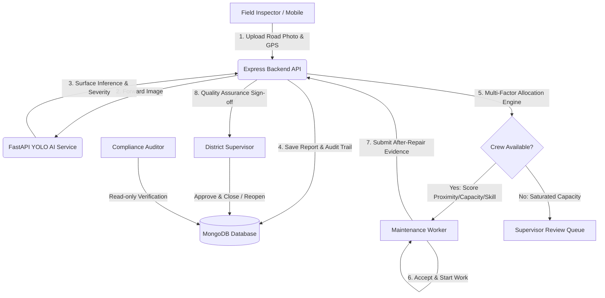

# AI Road Damage Reporting and Maintenance Tracking System

A full-stack, enterprise civil infrastructure management platform designed for autonomous pavement defect detection, multi-factor algorithmic maintenance crew dispatching, and full-lifecycle repair verification.

---

## Architecture Overview



---

## 1. Technology Stack

- **Frontend**: React 18, Vite, React Router 6, Bootstrap 5, Custom Infrastructure CSS, React Icons (`client/`).
- **Backend API**: Node.js 24, Express, Mongoose 8, JWT Authentication, bcryptjs, Multer (`server/`).
- **Database**: MongoDB 7.0 Enterprise with transactional consistency and geospatial indexes.
- **AI Microservice**: Python 3.11, FastAPI, Pydantic, Ultralytics YOLOv8 / Road Damage Dataset (RDD) inference pipeline (`ai-service/`).
- **Mapping**: Google Maps JavaScript API with interactive offline vector coordinate fallback.

---

## 2. User Roles & Security Matrix

Permissions are enforced strictly at the backend middleware layer (`server/src/middleware/rbac.js`):

| Role | Permissions & Permitted Scope |
| :--- | :--- |
| **Admin** | Unrestricted global access. Manage all users, service areas, assign jobs, verify repairs, view analytics, and inspect immutable audit logs. |
| **Supervisor** | District-scoped management. Review low-confidence AI predictions, monitor crew workloads, assign work, inspect before/after photos, and verify or reopen repairs within their territory. |
| **Field Inspector** | Field defect reporting. Upload high-resolution road photos, pin GPS coordinates, track their submitted reports. Cannot arbitrarily override AI severity ratings. |
| **Maintenance Worker** | Field repair crew. View only their own allocated tasks, accept/reject jobs with mandatory reasons, log on-site repairs, and upload after-repair evidence photos with material logs. |
| **Auditor** | Read-only compliance oversight. Inspect all damage reports, worker assignments, resolution speed metrics, and immutable audit logs. Cannot modify records. |

### Pre-Configured Demo Credentials (All 5 Roles)

| Role | Email | Password | Assigned Scope |
| :--- | :--- | :--- | :--- |
| **Admin** | `admin@roadguard.io` | `Admin@12345` | Global Operations |
| **District Supervisor** | `supervisor@roadguard.io` | `Supervisor@12345` | Central District |
| **Supervisor (North)** | `supervisor.north@roadguard.io` | `Supervisor@12345` | North Highway Corridor |
| **Field Inspector** | `inspector@roadguard.io` | `Inspector@12345` | Central District |
| **Maintenance Worker (Crew 1)** | `worker@roadguard.io` | `Worker@12345` | Central District |
| **Maintenance Worker (Crew 2)** | `worker.priya@roadguard.io` | `Worker@12345` | Central District |
| **Maintenance Worker (Crew 3)** | `worker.dave@roadguard.io` | `Worker@12345` | North Highway Corridor |
| **Auditor** | `auditor@roadguard.io` | `Auditor@12345` | Municipal Oversight |

---

## 3. Automatic Worker Allocation Engine

When a report is approved or ingested, the real allocation engine (`server/src/services/allocationService.js`) executes the following multi-factor evaluation:

1. **Eligibility Filtering**:
   - Active status: `active === true`
   - Jurisdictional Service Area match
   - Availability status: `available` or `on_duty`
   - Available capacity: `currentActiveJobs < maxConcurrentJobs`
2. **Multi-Factor Scoring (0 to 100 points)**:
   - **50% Proximity**: Haversine distance between crew current GPS coordinates and damage location (`100 - (distanceKm * 2)`).
   - **30% Available Capacity**: `((maxJobs - currentJobs) / maxJobs) * 100`.
   - **20% Skill & Equipment Match**: Matches required repair skills (e.g. `asphalt_patching`, `crack_sealing`) and tools (e.g. `compactor`, `hotbox`, `tar_kettle`).
   - **Composite Score**: `(0.50 * proximity) + (0.30 * capacity) + (0.20 * skill)`.
3. **Severity SLA Determination**:
   - `Critical`: 24-hour target completion deadline.
   - `High`: 48-hour target completion deadline.
   - `Medium`: 7-day target completion deadline.
   - `Low`: 14-day target completion deadline.
4. **Atomic Concurrency Protection**:
   Uses atomic MongoDB condition locks (`status: { $in: ['pending_assignment', 'unassigned'] }`) to guarantee zero duplicate assignments under concurrent dispatches.
5. **Capacity Saturation Fallback**:
   If no eligible crew has available capacity in the district, the report transitions safely to `unassigned`, and notifications are broadcast to district supervisors.

---

## 4. Full Repair Lifecycle State Machine

```
[Detected]
    │
    ├── (Confidence < 60%) ──► [Review Required] ──► (Supervisor Confirms) ──┐
    │                                                                        │
    └── (Confidence ≥ 60%) ──────────────────────────────────────────────────┴──► [Pending Assignment]
                                                                                        │
                                               (No Capacity in District) ──► [Unassigned]
                                                                                        │ (Auto-Allocated)
                                                                                        ▼
                                                                                   [Assigned]
                                                                                        │
                                                           (Crew Rejects) ◄─────────────┤
                                                                                        ▼ (Crew Accepts)
                                                                                   [Accepted]
                                                                                        │
                                                                                        ▼
                                                                                  [In Progress]
                                                                                        │ (After-Photo & Notes)
                                                                                        ▼
                                                                                   [Completed]
                                                                                        │
                                                   (Supervisor Reopens) ◄───────────────┤
                                                                                        ▼ (Supervisor Approves)
                                                                                   [Verified]
```

---

## 5. Real AI Model Integration & Engineering Notice

- **Microservice**: FastAPI at `http://127.0.0.1:8000`.
- **Supported Damage Classes**:
  - `D00`: Longitudinal Crack
  - `D10`: Transverse Crack
  - `D20`: Alligator Crack (Fatigue failure)
  - `D40`: Pothole (Pavement cavity)
  - `D43` / `D44`: Road Line & Crosswalk Marking Blur
  - `RUTTING` / `RAVELLING`: Structural rutting and aggregate disintegration
- **Severity vs Confidence**:
  Confidence and severity are strictly separated. A minor hairline crack with 0.45 confidence is flagged for **Review Required** without artificially inflating its severity.
- **Model Checkpoints**: Place weights at `ai-service/models/road_damage_yolov8.pt`. If weights are missing, the system operates in structured diagnostic mode with `model_loaded: false`, and marks reports for human supervisor confirmation.
- **Engineering Disclaimer**: Image-based computer vision evaluates visible surface pavement anomalies. Subsurface base course voids or exact physical depth cannot be measured from optical photography alone without ground-penetrating radar.

---

## 6. Directory Structure

```
├── client/                     # React 18 + Vite frontend
│   ├── src/
│   │   ├── api/                # Axios interceptors & base config
│   │   ├── components/         # Badges, Layout, Navbar, Sidebar, GoogleMap, Modals
│   │   ├── context/            # AuthContext & NotificationContext
│   │   ├── pages/              # 16 complete functional screens
│   │   ├── App.jsx             # RBAC Route Router
│   │   ├── index.css           # Modern infrastructure design tokens
│   │   └── main.jsx
├── server/                     # Node.js + Express backend
│   ├── src/
│   │   ├── config/             # MongoDB connection with graceful timeout
│   │   ├── middleware/         # JWT auth, strict RBAC, Multer upload, Error handler
│   │   ├── models/             # User, Department, DamageReport, Assignment, Evidence, etc.
│   │   ├── routes/             # REST API controllers
│   │   ├── services/           # Allocation engine, AI caller, Audit, Notifications
│   │   └── seed/               # Demo database seeder
│   ├── tests/                  # Jest integration & RBAC test suite
│   └── server.js
├── ai-service/                 # Python FastAPI inference microservice
│   ├── models/                 # Model checkpoints (.pt)
│   ├── config.py               # RDD class definitions & threshold settings
│   ├── detector.py             # Real YOLO detector & severity scoring
│   ├── main.py                 # /health, /model-info, /predict
│   └── tests/                  # Pytest test suite
├── .env.example                # Root environment configuration template
└── README.md
```

---

## 7. Quickstart & Installation

### Prerequisites
- Node.js >= 18 (Node 24 tested)
- Python >= 3.10
- MongoDB instance (e.g. `mongodb://127.0.0.1:27017`)

### 1. Configure Environment Files
Copy the `.env.example` templates:
```bash
cp .env.example server/.env
cp client/.env.example client/.env
cp ai-service/.env.example ai-service/.env
```

### 2. Install Dependencies
```bash
# Backend dependencies
cd server && npm install

# Frontend dependencies
cd ../client && npm install

# AI Microservice dependencies
cd ../ai-service && pip install -r requirements.txt
```

### 3. Seed Database
```bash
node server/src/seed/seedData.js
```

### 4. Start Services Independently
- **Backend API**:
  ```bash
  cd server && npm run dev
  # Serves at http://localhost:5000/api
  ```
- **Frontend Client**:
  ```bash
  cd client && npm run dev
  # Serves at http://localhost:5173
  ```
- **AI Inference Microservice**:
  ```bash
  cd ai-service && uvicorn main:app --host 0.0.0.0 --port 8000 --reload
  # Serves at http://127.0.0.1:8000 (Docs at /docs)
  ```

---

## 8. Automated Testing

### Backend Test Suite (RBAC, Allocation Engine, REST Contracts)
```bash
npm test --prefix server
```
*Results: 13 passed tests across 3 test suites (`rbac.test.js`, `allocation.test.js`, `api.test.js`).*

### AI Microservice Test Suite
```bash
cd ai-service && pytest
```

### Frontend Production Build
```bash
npm run build --prefix client
```
*Vite production bundle compiled with 0 errors.*
